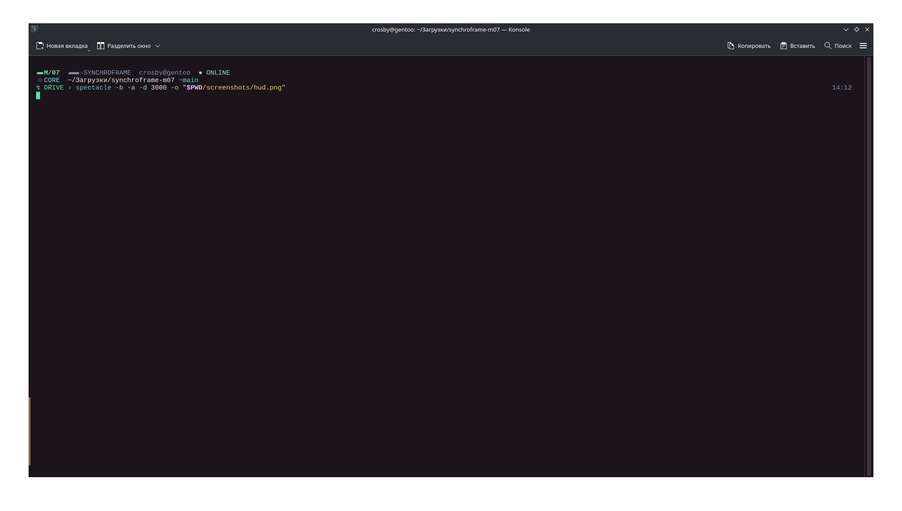
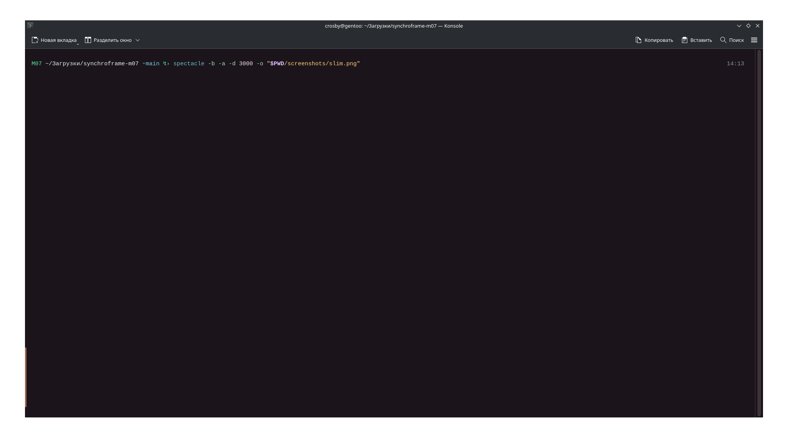

# SYNCHROFRAME M/07

Переносимая тема приглашения **Zsh** по исходникам пользователя с Gentoo (`mecha.zsh`, версия от 13.10.2026). Поддерживает широкое оформление HUD и компактный SLIM, root/SSH, Git и Python venv, а также интеграцию с NOCTIS/NLINE, если они имеются.

> В исходном архиве был только движок `mecha.zsh` и его резервная копия. Файлов `.colorscheme` и `.profile` для Konsole там не было, поэтому установщик **не изменяет** палитру, профиль, шрифт, системный конфиг Zsh или тему рабочего стола. Не обещает полностью воспроизвести чужую настройку Konsole.

## Требования

- Linux или другая POSIX-среда с `bash`, `zsh`, `awk`, `grep`, `cp`, `mktemp` (в Gentoo, Arch, Debian, Ubuntu обычные пакеты).
- `git` — для клонирования и обновления через GitHub.
- Терминал с поддержкой UTF-8, Unicode и truecolor (для корректного рендера символов и `#RRGGBB`). Nerd Font может помочь с отдельными символами.

## Установить с GitHub

1. Создайте публичный репозиторий `synchroframe` на GitHub, загрузите содержимое **этой** папки в корень репозитория.
2. На другом ПК установите `zsh` и `git`, затем выполните (вместо `USERNAME` ваш GitHub-логин):

```bash
mkdir -p "$HOME/.local/share"
git clone https://github.com/USERNAME/synchroframe.git "$HOME/.local/share/synchroframe"
bash "$HOME/.local/share/synchroframe/install.sh"
exec zsh
```

Не запускайте установщик через `sudo`: он рассчитан на текущего пользователя и его `$HOME`. Если Zsh использует нестандартный `ZDOTDIR`, передавайте его явно, например `ZDOTDIR="$HOME/.config/zsh" bash .../install.sh`.

Установщик проверяет синтаксис движка Zsh, сохраняет исходный `.zshrc` в `~/.local/state/synchroframe/` (или `$XDG_STATE_HOME/synchroframe/`) и добавляет **один отмеченный блок** в конец `.zshrc`. Прежние строки и файлы системного оформления не трогает. Если `.zshrc` — символическая ссылка, автоматически редактировать её **не будет** во избежание изменения dotfiles-репозитория.

> **Важно для исходного Gentoo:** если в `.zshrc` уже есть строка вроде `source /usr/local/share/mecha-synchroframe/mecha.zsh`, старый модуль может загрузиться первым, а новый не активируется из-за защитной переменной `__MECHA_LOADED`. После создания собственной резервной копии вручную отключите *только старую строку загрузки*. Не удаляйте всю `.zshrc`, системный каталог `/usr/local/share/mecha-synchroframe/` или NOCTIS без проверки.

## Команды темы

```zsh
mecha status
mecha doctor
mecha use hud
mecha use slim
mecha off
mecha on
mecha git clean
mecha git dirty
mecha title on
mecha title off
```

Новый установщик добавляет флаг `MECHA_AUTOSTART=1`, чтобы тема включалась в обычном Zsh. `mecha off` сохраняет настройку для последующих сеансов; `mecha on` её возвращает. Настройки новой установки сохраняются **отдельно** от существующего NOCTIS: `${XDG_CONFIG_HOME:-$HOME/.config}/synchroframe/layout`. Исходные режимы запуска через NOCTIS/MECHA по-прежнему работают, если движок загружается вне установленного блока.

Для подсказки root-контекста и смены цвета курсора тема использует OSC 12/112 в совместимых терминалах. При необходимости отключите этот эффект: `MECHA_CURSOR_SYNC=0` в настройках до загрузки темы. Настройка `mecha palette` предназначена только для Konsole, где пользователь **самостоятельно** создал/установил палитру `MECHA-Synchroframe`; палитра в архив не вошла.

## Обновить

```bash
bash "$HOME/.local/share/synchroframe/update.sh"
exec zsh
```

Работает только при установке из Git-клона и отказывается делать `git pull`, если имеются незакоммиченные изменения. После обновления также проверяет синтаксис движка Zsh.

## Удалить и вернуть прежнее приглашение

```bash
bash "$HOME/.local/share/synchroframe/uninstall.sh"
exec zsh
```

Удаляется только блок SYNCHROFRAME. Если `.zshrc` не меняли после установки, восстанавливаются **точные исходные байты** из резервной копии (либо удаляется созданный установщиком пустой `.zshrc`). Если файл редактировался — удаляется лишь отмеченный блок, без сброса остальных правок. Резервная копия остаётся в `~/.local/state/synchroframe/`.

Для отключения и **удаления чистого Git-клона** за одну операцию:

```bash
bash "$HOME/.local/share/synchroframe/uninstall.sh" --purge
exec zsh
```

Вариант `--purge` **сохраняет** проект, если в нём обнаружены локальные правки, неотслеживаемые/игнорируемые файлы либо это распакованный ZIP вместо Git-клона. В таком случае проверьте папку и удалите её вручную. Конфигурация `${XDG_CONFIG_HOME:-$HOME/.config}/synchroframe/layout` остаётся на диске для возможной повторной установки; при желании удалите вручную только этот файл.

Удаление не отменяет ничего, что вручную менялось вне установщика — системный Zsh, Konsole, шрифты, старые NOCTIS/NLINE, плагины. Новая тема **не заменяет** прежнюю системную установку сама.


Перед публикацией проверьте код и исключите персональные данные. Бэкап `mecha.zsh.before-safecore.bak` в репозиторий сознательно не включён. Авторские права/лицензирование кода остаются за его правообладателем; лицензия автоматически не назначена.

## Особые случаи

- Если вы пользуетесь Zsh с root через `sudo -i`, это **отдельный** `$HOME` и `.zshrc`. Не устанавливайте в root автоматически. При желании настройте root отдельно после тестирования под обычным пользователем.
- Если `mecha off` возвращает не то приглашение в уже открытой оболочке, запустите **новый** Zsh после деинсталляции: ранее загруженные функции остаются в памяти до завершения сеанса.
- Если `.zshrc` содержит конфликты, неполные маркеры, или является symlink, установщик/деинсталлятор **останавливается** и не пытается угадать правильный результат.
- Если вы хотите, чтобы тема запускалась только в определённых терминалах, настройте условие в управляемом блоке `.zshrc` вместо глобального `MECHA_AUTOSTART=1`.

## Screenshots

### SYNCHROFRAME M/07 — HUD


### SYNCHROFRAME M/07 — SLIM


